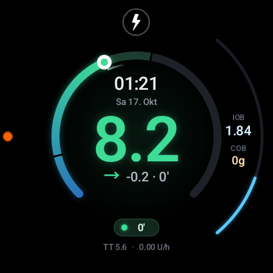
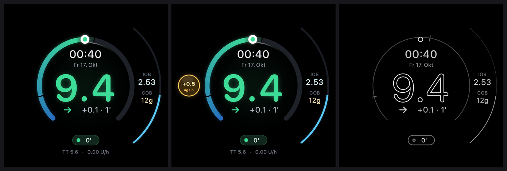
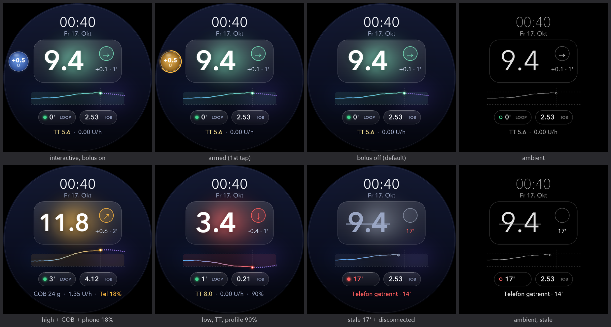
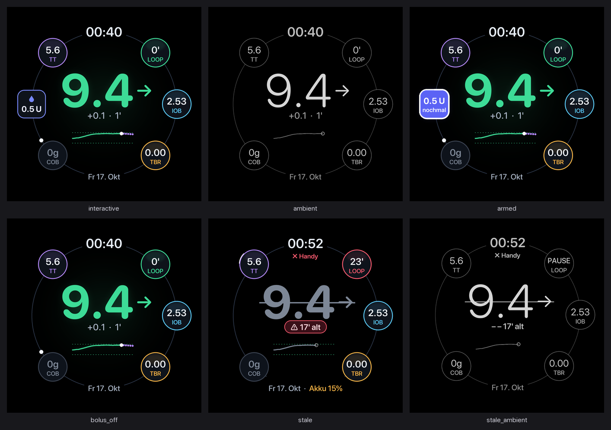
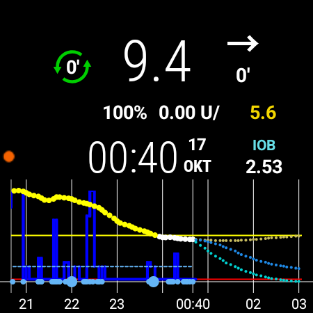

# AAPS Kusi watch faces

Design record for the three native watch faces of this build: **AAPS Halo**, **AAPS Glass** and **AAPS Orbit**.
The code lives in the `wear` module (branch `feature/kusi/watchface-fancy`, merged into `feature/kusi/3.4.2.6`).

## Decisions (owner, 2026-10-17)

- Built natively (own `WatchFaceService` per face), not as CWF zips: a CWF cannot do the bolus tap,
  an ambient design or the IOB arc, and importing one replaces the active custom face. See `review/`.
- Names: "AAPS Halo", "AAPS Glass", "AAPS Orbit". AAPS Halo is the active face after install.
- German date under the time, e.g. "Fr 17. Okt". mmol/L for the owner; mg/dL must work.
- Bolus ball: 0.5 U preset. A double tap only sends `ActionBolusPreCheck`; the phone checks limits
  and shows the standard confirmation; nothing is delivered without confirming there. Never active
  in ambient; 800 ms double-tap window, 5 s cooldown, max-bolus and phone-connection checks.
- Phone side: bolus requests from the watch are refused when Wear control is off; a confirmation is
  only accepted if it matches the last pending request (same amount, within 60 s, once).

## Gallery

**AAPS Halo, live on the Galaxy Watch5 Pro (01:21)** and the rendered states:

 

**AAPS Glass** (final design, all states):

**AAPS Orbit** (final design, all states):

**Previous face** (custom watchface, for comparison):

New screenshots from the watch are added to `screenshots/` after each build.

## Contents

| Folder | What |
|---|---|
| `concepts/` | First concepts (Halo, Glass, Orbit) with their Pillow generators |
| `designs/` | Final Glass and Orbit mockups (all states) and their implementation specs |
| `designsystem/` | State catalogue and per-face state matrices (added when finished) |
| `review/` | Native vs CWF vs hybrid comparison, CWF engine notes |
| `screenshots/` | Real screenshots from the Galaxy Watch5 Pro (current face, then each build) |
| `gallery/` | The gallery page (`index.html` + images), also published as a claude.ai artifact |
